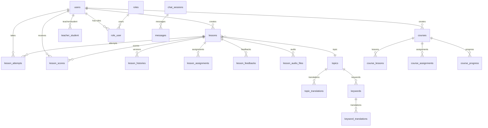

# 🗄️ Database Schema

## Overview

- **DBMS:** PostgreSQL 17.7
- **Extensions:** pgvector (for vector search)
- **Tables:** 40
- **Size:** ~4.72 MB

## ER Diagram (Main Entities)



## Tables by Domain

### 👤 Users

#### `users`
| Column | Type | Description |
|--------|------|-------------|
| id | bigint | PK |
| uuid | uuid | Unique identifier |
| first_name | varchar(255) | First name |
| last_name | varchar(255) | Last name |
| email | varchar(255) | Email (unique) |
| password | varchar(255) | Password hash |
| native_lang | varchar(255) | Native language (default: 'vi') |
| is_temp_guest | boolean | Temporary guest |
| temp_guest_expires_at | timestamp | Guest expiration |
| is_banned | boolean | Banned |
| is_looking_for_teacher | boolean | Looking for teacher |
| is_accepting_students | boolean | Accepting students |
| settings | json | User settings |

#### `roles` / `role_user`
Role system (admin, teacher, student).

#### `teacher_student`
Teacher-student relationship (many-to-many).

---

### 📚 Lessons

#### `lessons`
| Column | Type | Description |
|--------|------|-------------|
| id | bigint | PK |
| uuid | uuid | Unique identifier |
| user_id | bigint | FK → users |
| topic_id | smallint | FK → topics |
| lesson_name | varchar(255) | Lesson name |
| lesson_text | text | Lesson text |
| language_level | varchar(2) | CEFR level (A1-C2) |
| lesson_lang | varchar(255) | Lesson language |
| status | varchar(255) | Status (created, creation, regeneration, archived, exists, error) |
| grammar_data | json | Grammar |
| vocabulary | json | Vocabulary |
| dialogue | json | Dialogues |
| exercises | json | Exercises |
| homework | text | Homework |
| common_mistakes | json | Common mistakes |
| culture_notes | text | Culture notes |
| **embedding** | **vector(1536)** | **Vector embedding (pgvector)** |

#### `lesson_histories`
Lesson version history. Structure similar to `lessons` + `lesson_id`.

#### `lesson_audio_files`
| Column | Type | Description |
|--------|------|-------------|
| lesson_id | bigint | FK → lessons |
| audio_type | varchar(255) | Type (vocabulary, gap_fill) |
| audio_key | varchar(255) | Audio key |
| file_path | varchar(255) | File path |
| status | varchar(255) | pending / ready / failed |

---

### 📝 Grading

#### `lesson_assignments`
Lesson assignments from teachers to students.

| Column | Type | Description |
|--------|------|-------------|
| lesson_id | bigint | FK → lessons |
| teacher_id | bigint | FK → users |
| student_id | bigint | FK → users |
| assigned_version | json | Exercises snapshot |
| status | varchar(20) | pending / in_progress / completed |
| due_date | timestamp | Due date |

#### `lesson_attempts`
Lesson attempts.

| Column | Type | Description |
|--------|------|-------------|
| lesson_id | bigint | FK → lessons |
| user_id | bigint | FK → users |
| assignment_id | bigint | FK → lesson_assignments (nullable) |
| attempt_number | int | Attempt number |
| exercises_snapshot | json | Exercises snapshot |
| user_answers | json | User answers |
| is_completed | boolean | Completed |

#### `lesson_scores`
Results/scores.

| Column | Type | Description |
|--------|------|-------------|
| attempt_id | bigint | FK → lesson_attempts |
| total_questions | int | Total questions |
| correct_answers | int | Correct answers |
| score_percentage | numeric(5,2) | Percentage |
| auto_graded | boolean | Auto graded |
| teacher_comment | text | Teacher comment |

#### `lesson_feedbacks` / `lesson_feedback_history`
User feedbacks (like/dislike) and history.

---

### 📖 Courses

#### `courses`
| Column | Type | Description |
|--------|------|-------------|
| uuid | uuid | Unique identifier |
| user_id | bigint | FK → users (creator) |
| title | varchar(255) | Title |
| language_level | varchar(2) | CEFR level |
| is_published | boolean | Published |
| passing_score | int | Passing score (default: 70) |

#### `course_lessons`
Course-lessons relationship with order.

#### `course_assignments`
Course assignments to students.

#### `course_progress`
Student progress on courses.

---

### 🏷️ Topics and Keywords

#### `topics`
| Column | Type | Description |
|--------|------|-------------|
| slug | varchar(255) | URL-slug |
| is_system | boolean | System topic |
| is_approved | boolean | Approved |

#### `topic_translations`
Topic translations to different languages.

#### `keywords`
Keywords linked to topics.

#### `keyword_translations`
Keyword translations.

#### `user_topic_visibility` / `user_keyword_visibility`
User visibility settings for topics/keywords.

---

### 💬 Chat and Messages

#### `chat_sessions`
Support chat sessions.

#### `messages`
Support chat messages.

#### `user_messages`
Private messages between users (teacher ↔ student).

---

### 👨‍🏫 Teachers

#### `teacher_invitations`
Teacher invitations to students.

#### `teacher_reviews`
Student reviews of teachers.

---

### 🛡️ Security

#### `user_blocks`
User blocks.

#### `user_reports`
User reports.

---

### 🔧 System Tables

| Table | Description |
|-------|-------------|
| `migrations` | Laravel migrations |
| `sessions` | User sessions |
| `cache` / `cache_locks` | Cache |
| `jobs` / `job_batches` / `failed_jobs` | Queues |
| `notifications` | Notifications |
| `password_reset_tokens` | Password reset tokens |

---

## Indexes and Foreign Keys

Full SQL schema: [`DATABASE_SCHEMA.sql`](./DATABASE_SCHEMA.sql)

## pgvector Extension

Used for semantic search of similar lessons:

```sql
CREATE EXTENSION IF NOT EXISTS vector;

-- embedding field in lessons table
embedding vector(1536)

-- Cosine distance search
SELECT *, 1 - (embedding <=> $1) as similarity
FROM lessons
WHERE 1 - (embedding <=> $1) >= 0.9
ORDER BY similarity DESC;
```

## Schema Generation

```bash
# Export full SQL schema
docker exec ai-demo-pgsql-1 pg_dump -U sail -d laravel --schema-only --no-owner > docs/DATABASE_SCHEMA.sql

# View tables and sizes
docker exec ai-demo-laravel.test-1 php artisan db:show --counts
```
