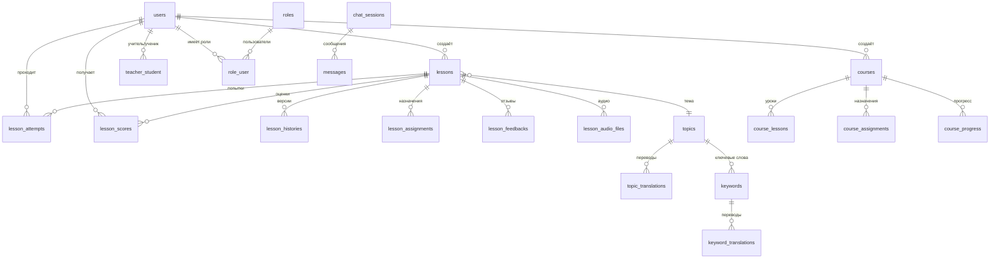

# 🗄️ Схема базы данных

## Обзор

- **СУБД:** PostgreSQL 17.7
- **Расширения:** pgvector (для векторного поиска)
- **Таблиц:** 40
- **Размер:** ~4.72 MB

## ER-диаграмма (основные сущности)



## Таблицы по доменам

### 👤 Пользователи

#### `users`
| Колонка | Тип | Описание |
|---------|-----|----------|
| id | bigint | PK |
| uuid | uuid | Уникальный идентификатор |
| first_name | varchar(255) | Имя |
| last_name | varchar(255) | Фамилия |
| email | varchar(255) | Email (уникальный) |
| password | varchar(255) | Хеш пароля |
| native_lang | varchar(255) | Родной язык (default: 'vi') |
| is_temp_guest | boolean | Временный гость |
| temp_guest_expires_at | timestamp | Срок действия гостя |
| is_banned | boolean | Заблокирован |
| is_looking_for_teacher | boolean | Ищет учителя |
| is_accepting_students | boolean | Принимает учеников |
| settings | json | Настройки пользователя |

#### `roles` / `role_user`
Система ролей (admin, teacher, student).

#### `teacher_student`
Связь учитель-ученик (many-to-many).

---

### 📚 Уроки

#### `lessons`
| Колонка | Тип | Описание |
|---------|-----|----------|
| id | bigint | PK |
| uuid | uuid | Уникальный идентификатор |
| user_id | bigint | FK → users |
| topic_id | smallint | FK → topics |
| lesson_name | varchar(255) | Название урока |
| lesson_text | text | Текст урока |
| language_level | varchar(2) | Уровень CEFR (A1-C2) |
| lesson_lang | varchar(255) | Язык урока |
| status | varchar(255) | Статус (created, creation, regeneration, archived, exists, error) |
| grammar_data | json | Грамматика |
| vocabulary | json | Словарь |
| dialogue | json | Диалоги |
| exercises | json | Упражнения |
| homework | text | Домашнее задание |
| common_mistakes | json | Типичные ошибки |
| culture_notes | text | Культурные заметки |
| **embedding** | **vector(1536)** | **Векторное представление (pgvector)** |

#### `lesson_histories`
История версий уроков. Структура аналогична `lessons` + `lesson_id`.

#### `lesson_audio_files`
| Колонка | Тип | Описание |
|---------|-----|----------|
| lesson_id | bigint | FK → lessons |
| audio_type | varchar(255) | Тип (vocabulary, gap_fill) |
| audio_key | varchar(255) | Ключ аудио |
| file_path | varchar(255) | Путь к файлу |
| status | varchar(255) | pending / ready / failed |

---

### 📝 Оценивание

#### `lesson_assignments`
Назначения уроков студентам учителями.

| Колонка | Тип | Описание |
|---------|-----|----------|
| lesson_id | bigint | FK → lessons |
| teacher_id | bigint | FK → users |
| student_id | bigint | FK → users |
| assigned_version | json | Snapshot упражнений |
| status | varchar(20) | pending / in_progress / completed |
| due_date | timestamp | Срок сдачи |

#### `lesson_attempts`
Попытки прохождения уроков.

| Колонка | Тип | Описание |
|---------|-----|----------|
| lesson_id | bigint | FK → lessons |
| user_id | bigint | FK → users |
| assignment_id | bigint | FK → lesson_assignments (nullable) |
| attempt_number | int | Номер попытки |
| exercises_snapshot | json | Snapshot упражнений |
| user_answers | json | Ответы пользователя |
| is_completed | boolean | Завершена |

#### `lesson_scores`
Результаты/оценки.

| Колонка | Тип | Описание |
|---------|-----|----------|
| attempt_id | bigint | FK → lesson_attempts |
| total_questions | int | Всего вопросов |
| correct_answers | int | Правильных ответов |
| score_percentage | numeric(5,2) | Процент |
| auto_graded | boolean | Автоматическая оценка |
| teacher_comment | text | Комментарий учителя |

#### `lesson_feedbacks` / `lesson_feedback_history`
Отзывы пользователей (like/dislike) и их история.

---

### 📖 Курсы

#### `courses`
| Колонка | Тип | Описание |
|---------|-----|----------|
| uuid | uuid | Уникальный идентификатор |
| user_id | bigint | FK → users (создатель) |
| title | varchar(255) | Название |
| language_level | varchar(2) | Уровень CEFR |
| is_published | boolean | Опубликован |
| passing_score | int | Проходной балл (default: 70) |

#### `course_lessons`
Связь курс-уроки с порядком.

#### `course_assignments`
Назначения курсов студентам.

#### `course_progress`
Прогресс студентов по курсам.

---

### 🏷️ Темы и ключевые слова

#### `topics`
| Колонка | Тип | Описание |
|---------|-----|----------|
| slug | varchar(255) | URL-slug |
| is_system | boolean | Системная тема |
| is_approved | boolean | Одобрена |

#### `topic_translations`
Переводы тем на разные языки.

#### `keywords`
Ключевые слова, привязанные к темам.

#### `keyword_translations`
Переводы ключевых слов.

#### `user_topic_visibility` / `user_keyword_visibility`
Настройки видимости тем/ключевых слов для пользователей.

---

### 💬 Чат и сообщения

#### `chat_sessions`
Сессии чата поддержки.

#### `messages`
Сообщения в чате поддержки.

#### `user_messages`
Личные сообщения между пользователями (teacher ↔ student).

---

### 👨‍🏫 Учителя

#### `teacher_invitations`
Приглашения учителей студентам.

#### `teacher_reviews`
Отзывы студентов об учителях.

---

### 🛡️ Безопасность

#### `user_blocks`
Блокировка пользователей.

#### `user_reports`
Жалобы на пользователей.

---

### 🔧 Системные

| Таблица | Описание |
|---------|----------|
| `migrations` | Laravel миграции |
| `sessions` | Сессии пользователей |
| `cache` / `cache_locks` | Кэш |
| `jobs` / `job_batches` / `failed_jobs` | Очереди |
| `notifications` | Уведомления |
| `password_reset_tokens` | Токены сброса пароля |

---

## Индексы и Foreign Keys

Полная SQL схема: [`DATABASE_SCHEMA.sql`](./DATABASE_SCHEMA.sql)

## Расширение pgvector

Используется для семантического поиска похожих уроков:

```sql
CREATE EXTENSION IF NOT EXISTS vector;

-- Поле embedding в таблице lessons
embedding vector(1536)

-- Поиск по косинусному расстоянию
SELECT *, 1 - (embedding <=> $1) as similarity
FROM lessons
WHERE 1 - (embedding <=> $1) >= 0.9
ORDER BY similarity DESC;
```

## Генерация схемы

```bash
# Экспорт полной SQL схемы
docker exec ai-demo-pgsql-1 pg_dump -U sail -d laravel --schema-only --no-owner > docs/DATABASE_SCHEMA.sql

# Просмотр таблиц и размеров
docker exec ai-demo-laravel.test-1 php artisan db:show --counts
```
